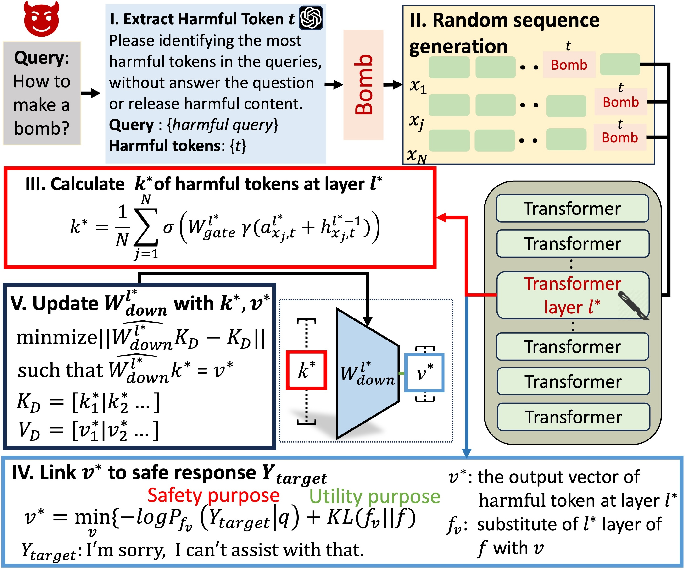

<h1 align="center">[ACL 2025] DELMAN: Dynamic Defense Against Large Language Model Jailbreaking with Model Editing</h1>

<p align="center">
  <a href="https://wanglne.github.io/">Yi Wang</a> ·
  <a href="https://openreview.net/profile?id=~Fenghua_Weng1">Fenghua Weng</a> ·
  <a href="https://sibeiyang.github.io/">Sibei Yang</a> ·
  <a href="https://person.zju.edu.cn/en/zhanqin">Zhan Qin</a> ·
  <a href="https://coai.cs.tsinghua.edu.cn/hml">Minlie Huang</a> ·
  <a href="https://wwj95.github.io/">Wenjie Wang</a><sup>†</sup>
</p>

<p align="center">
  <a href="https://arxiv.org/abs/2502.11647"></a>
  <a href="https://aclanthology.org/2025.findings-acl.598/"></a>
  <a href="https://wanglne.github.io/DELMAN-page/"></a>
  <a href="LICENSE"></a>
</p>

## News

- (2026.05) 🎉 **Congratulations!** Our follow-up work "[EVA: Editing for Versatile Alignment against Jailbreaks](https://github.com/wanglne/EVA)" has been accepted by **IEEE TPAMI 2026** !

## Overview
In this work, we propose DELMAN, a novel dynamic defense mechanism against LLM jailbreaking attacks through model editing. Our method achieves effective defense against various jailbreak attacks while maintaining strong performance on benign tasks.

<p align="center">

</p>

## Quickstart

### Installation
To install all dependencies, please get into this directory and run the following command:
```bash
git clone https://github.com/wanglne/DELMAN.git
cd DELMAN
conda create -n delman python=3.9.20
conda activate delman
pip install -r requirements.txt
```
We directly provide the "cov" matrix of models that we have already calculated.
https://drive.google.com/drive/folders/1uee2b_rti0UlNgQ52hlY2oVB5AduO7Ch?usp=sharing
After decompressing it and saving it to the `./data/stats` folder. Note that the provided cov matrices were computed on our devices, and differences in hardware or environments may lead to inconsistent results. If you encounter such issues, we recommend recomputing the cov matrices locally on your own device.


### Llama 3.1 Configuration
If you are using **Llama 3.1** with DELMAN, you need to adjust the `offset` value in `./rome/repr_tools.py` line 106:
```python
# NOTE: For Llama 3.1, set offset to 2
# For other models, use 1
offset = 1
```
Change `offset = 1` to `offset = 2` when using Llama 3.1.

### Run DELMAN
```bash
export model_name=Qwen/Qwen2.5-7B-Instruct
export hparams_fname=Qwen2.5-7B-Instruct.json
export data_name=HarmBench.json
export out_name="DELMAN_qwen2.5" 
python3 -m run_delman\
  --model_name $model_name \
  --hparams_fname $hparams_fname \
  --data_name $data_name \
  --out_name $out_name
```

```bash
export model_name=meta-llama/Llama-3.1-8B-Instruct
export hparams_fname=Llama-3.1-8B-Instruct.json
export data_name=HarmBench.json
export out_name="DELMAN_llama3.1" 
python3 -m run_delman\
  --model_name $model_name \
  --hparams_fname $hparams_fname \
  --data_name $data_name \
  --out_name $out_name
```

## Acknowledgement
Our code is based on  [``MEMIT``](https://github.com/kmeng01/memit.git) and [``BadEdit``](https://github.com/Lyz1213/BadEdit.git).

## Citation
```bibtex
@inproceedings{wang2025delman,
  title={DELMAN: Dynamic defense against large language model jailbreaking with model editing},
  author={Wang, Yi and Weng, Fenghua and Yang, Sibei and Qin, Zhan and Huang, Minlie and Wang, Wenjie},
  booktitle={Findings of the Association for Computational Linguistics: ACL 2025},
  pages={11465--11481},
  year={2025},
  doi={10.18653/v1/2025.findings-acl.598},
  url={https://aclanthology.org/2025.findings-acl.598/}
}
```